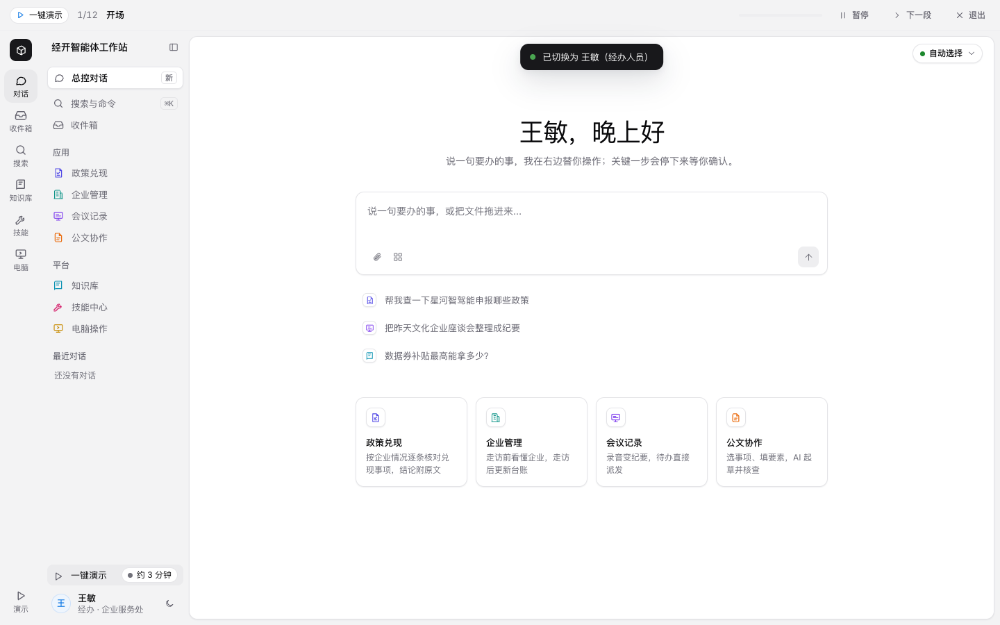
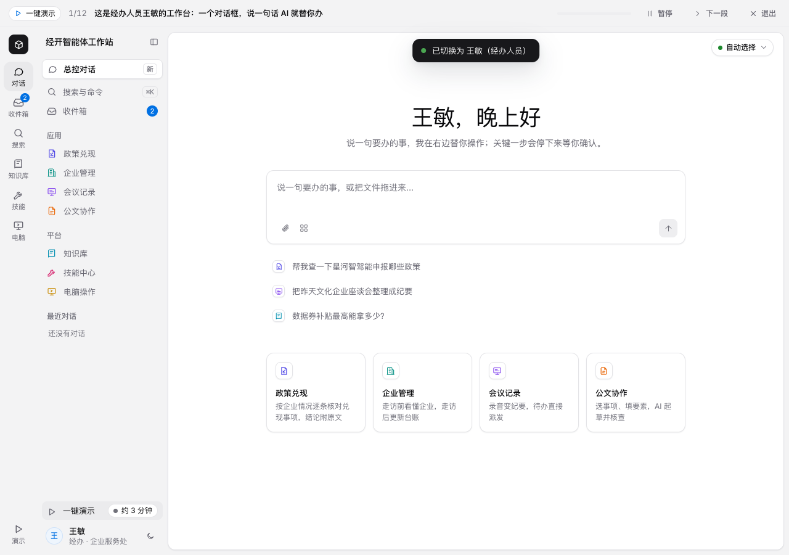

# 写一个经开区小应用

## 方式一：在 v4 原型中添加模块（`web/apps/<id>/`）

1. 先按 Issue 确认应用 ID、角色权限、入口路由及目标操作。当前原型应用契约位于 [APP_CONTRACT.md](../APP_CONTRACT.md)。核对 [接口规范 v1.3](../接口规范.md) 的请求、响应和错误码。
2. 以相邻应用为例，在 `web/apps/<id>/` 目录调用 `JK.registerApp`。manifest 的 `id` 与目录名一致，列出 `routes`、`perms` 和 `intents`。将应用登记到 `web/config/apps.js`（`web/index.html` 会按配置顺序自动载入 `mock/<id>.js`、`api/<id>.js` 与应用脚本）。
3. `mount(el, ctx)` 只在 `el` 内渲染，通过 `ctx.api` 访问数据。返回 `go(route, params)` 与 `actions`，使首次打开、再次跳转及对话调用都能到达同一业务对象。绑定的监听器在 `unmount` 中释放。
4. 使用公开样例覆盖成功、空数据和权限不足。双击 `web/index.html`，用演示账号从侧栏和对话分别进入；核对首屏、深链参数、主题和授权。将最短可验证操作写进 `manifest.demo`，实跑一键演示。
5. 用 1440px 与 1280px 视口复测并截图。下列示例是两个宽度的演示入口，可作为视口与截图格式的参照。

## 方式二：在平台根目录编写正式小应用（`apps/<id>/`）

若 Issue 要求基于平台底座与 SDK 编写独立小应用，请从模板生成并遵循平台质量门：

1. 使用 `python3 scripts/new_app.py <id> "<名称>" --owner <用户名>`（Windows 用 `python`）从模板生成 `apps/<id>/`。
2. 补齐 `app.json` 与 `README.md` 中的需求七问，按 [apps/_template/README.md](../../apps/_template/README.md) 与 [core/README.md](../../core/README.md) 启动平台联调。
3. 提交前安装 `requirements-dev.txt`，执行 `python3 scripts/check.py --app <id>` 与全量 `python3 scripts/check.py`。
