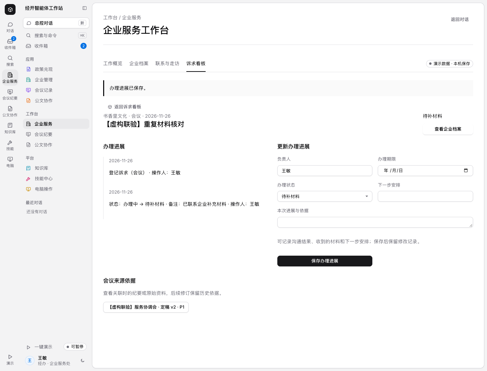
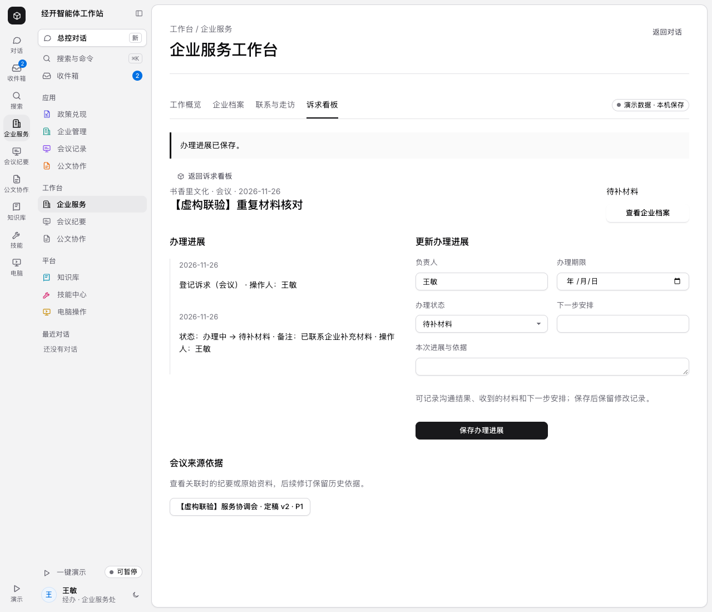

# 三个工作台与政策岗位模式实施记录（#224）

2026-11-26。本记录对应已确认的三工作台与一岗位模式范围，不改动原四个应用的分级和位置。

## 使用入口与同源记录

侧栏新增「工作台」分组：企业服务、会议纪要、公文协作。原政策兑现、企业管理、会议记录、公文协作应用保留，工作台通过原业务接口处理同一批记录。总控对话可选择「通用助手 / 政策服务专员」；岗位和服务企业按会话保存，切换账号或新建会话不继承上一会话的企业。

- 企业服务以企业档案、联系与走访、诉求看板持续办理，保留负责人、期限、状态和历史；编辑只提交实际改动字段，避免补记进展时回退其他人的更新。
- 会议纪要保存文字与录音原件、原文段落、核对修订及固定定稿版本；经办人核对后确认定稿。行动项与收件箱共用办理状态，改派、改期、重开均保留原因。
- 公文协作以文稿档案、我的修改、待我审签和已定稿视图继续既有文稿，保留正文版本、核查、批注、审签与真实 Word 导出；旧入口提交过期版本会被拒绝。
- 政策岗位每轮先调用政策查询，再结合当前企业和问题组织有原文依据的回复；缺少依据时明确缺口，不承诺申报资格或审批结果。页面使用「根据企业信息，查找可能适用的政策支持，查看申请条件和原文依据。」；输出名称为「政策参考清单」，保留原 notice 接口和旧输入别名。

详细边界见 [企业服务工作台](企业服务工作台.md)、[会议纪要工作台实施说明](会议纪要工作台实施说明.md)、[公文协作说明](../../apps/document/README.md) 与 [政策服务岗位模式](政策服务岗位模式.md)。

## 跨工作台办理

会议「关联记录」可选择有权查看的企业诉求，并注明来源段落。关联后的会议回读诉求当前状态；企业诉求详情可返回当时的固定会议定稿或未定稿来源快照，后续来源修订不会覆盖已有依据。无会议权限时不展示回链，服务端再次核验来源与目标权限。会议来源暂时不可用时，企业诉求仍可独立办理。

会议「先登记新诉求，再返回关联」直接打开企业诉求表单。首期由经办人保存诉求后返回会议确认关联；不会因跳转自动创建或办结诉求。`issues?action=new&company=企业ID` 可预选企业。

已定稿会议可转为公文草稿。公文服务按授权和固定版本读取会议正文，忽略客户端提供的正文或标题；双方分别保留后续修订。公文来源按钮返回对应会议定稿。普通纪要由经办人确认，需正式审签的事项进入公文流程。

## 集成验证与使用边界

新增 `web/tests/workbenches/integration-browser.cjs` 覆盖新诉求表单、会议关联与企业回链、未定稿来源快照、无权限回链、公文转入及后续修订不改写旧依据。实际 Chrome 已验证新增四条流程；合并后的工作台、岗位模式及公共壳浏览器回归共 41 项通过。各子任务独立复核发现的问题均以对应修复提交与测试留证，最终全库结果记录在总单 PR。

保留 file:// 与离线演示；连接服务时使用真实业务接口。真实云转写和现场麦克风的连通性、中断恢复尚需部署环境实测，不能把固定示例当成真实转写。政策支持范围取决于当前已收录且可访问的政策库。

本地预览可直接打开 `web/index.html`；静态 HTTP 预览使用 `?api=mock`。正式 HTTP 模式需要本地服务及有效登录。没有部署或写入其他 HA 节点。

## 集成页面

