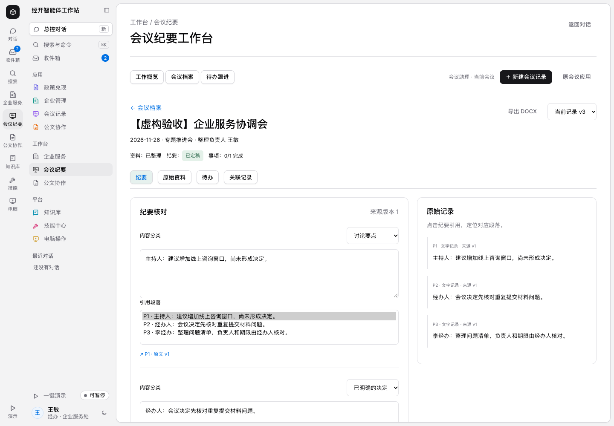
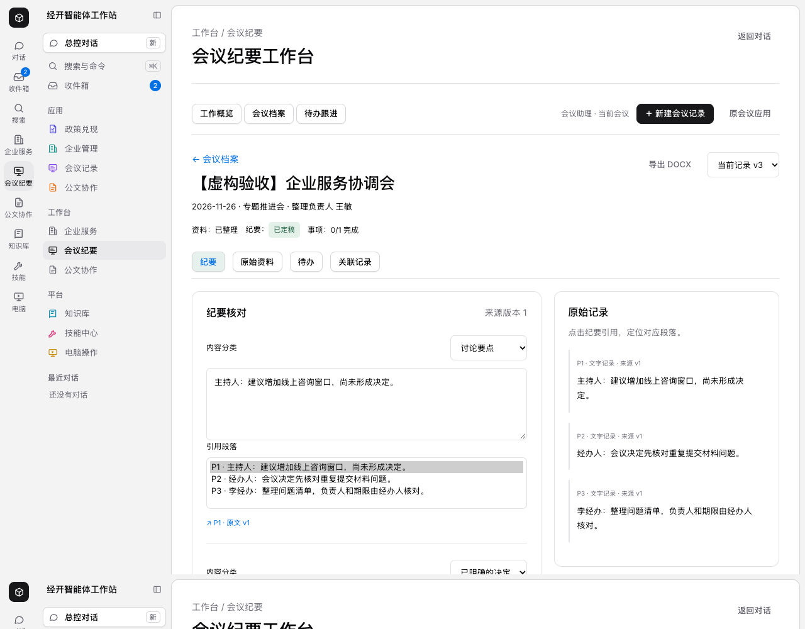

# 会议纪要工作台实施说明（#227）

日期：2026-11-26。对应已认可的《会议纪要工作台设计草案》，本文件记录实现与验证，不修改冻结设计。

工作台包含概览、档案、待办看板/列表以及纪要、原始资料、待办、关联记录四个详情页签。页面状态通过工作台 `recordId` 保存：`overview`、`archive`、`todos`、`new`、`example`，或 `会议ID~页签~版本`。`~minutes~N` 只读固定定稿；`~sources~N` 只读关联当时的来源记录（包括未定稿版本），对应 GET 的 `snapshot=1`。原始会议 ID 可直接打开纪要。原会议应用入口保留。

## 记录与权限

- 复用 `type=meeting` 和原记录 ID；平台版本库持久保存所有修订。
- `ownerId` 指定整理负责人；旧记录缺少该字段时按第 1 版创建者确定。operate 与负责人检查同时成立才可修改、定稿、派发，admin 显式例外；旧入口及通用转写任务的实际写入边界使用同一检查。
- `sourceVersion` 与来源段落 ID 共同标识出处。文字段落使用 P1 等，原音频段落使用 L1 等，时间戳保留为回听位置。重复时间戳不会合并来源身份。
- `minutesEdit` 保存人工纪要，`minutesStatus` 独立于转写状态；定稿时 `finalizedVersion` 等于保存后的平台版本。修订不删除旧定稿。
- `todos[].assignment` 保存唯一派发 ID、接收人和源定稿/资料版本。完成状态沿用原收件箱表，增加 status/note/history；无行表示待处理，既有行缺省已完成，取消在收件箱收束到已处理。
- 实例关闭通用 meeting records POST/PUT；旧会议 API 仍可读取工作台记录，但工作台记录的无版本修改与旧式派发不能绕过校验。

## 新接口

路径前缀：`/api/apps/meeting/workbench`。

| 方法与路径 | 作用 |
| --- | --- |
| GET `/meetings` | 按当前应用与项目授权列出会议，含三个独立状态与当前任务进展 |
| POST `/meetings` | `{title,date,type?,text?,place?,participants?}` 新建文字或空记录 |
| GET `/members?project=jkq` | 当前项目中有会议 view 权限的在用成员 |
| GET `/meetings/{id}?version=N` | 当前记录或固定定稿；返回 `{item,minutes,versions}` |
| PATCH `/meetings/{id}` | `baseVersion` 必填，可修订 title/date/text/minutes/todos |
| POST `/meetings/{id}/candidate` | 调模型生成带来源候选，返回 candidate/baseVersion，不写记录 |
| POST `/meetings/{id}/finalize` | `{baseVersion,checked:true}` 经办人核对定稿 |
| POST `/meetings/{id}/dispatch` | `{ids}` 校验成员、来源、绝对日期、已定稿并幂等派发 |
| PATCH `/meetings/{id}/todos/{todoId}/progress` | `{status,note}` 指定负责人办理/完成，整理负责人可取消或原因重开 |
| POST `/meetings/{id}/todos/{todoId}/reassign` | `{baseVersion,previousOwnerId,ownerId,due,note}` 核对原版本/原负责人，调整接收人与期限；已完成/取消须先说明原因重开 |
| POST `/meetings/{id}/supplements` | `{baseVersion,text,source}` 添加服务器标记补充人/时间/出处的会后来源 |
| POST `/meetings/{id}/restore` | `{baseVersion,fromVersion}` 将固定定稿恢复为新待核对草稿，不倒退任务状态 |
| POST `/meetings/{id}/audio` | multipart `baseVersion,file` 给原会议补录音原件，沿用原 ID、保存校验与大小限制 |
| POST `/meetings/{id}/retry-transcription` | 在原持久任务上重试失败转写，保留已保存录音 |
| GET `/meetings/{id}/export?version=N` | 真实 DOCX；草稿有标识，定稿含版本、确认人和时间 |
| POST `/meetings/{id}/links` | `{app:'enterprise'或'document',id,version?,sourceRef?}` 授权后保存幂等关联 |
| GET `/links?app=enterprise&id=诉求ID` | 先核对目标资源权限，再返回当前有权查看的来源会议回链 |

回链结构为 `{items:[{app,id,version,sourceRef,sourceVersion,finalized,meetingId,title,by,at}]}`。企业工作台可按 finalized 选择固定纪要或来源历史路由，在 #227 集成时消费，目标诉求状态从企业接口回读。不能因登记诉求而自动将其办结。

公文调用 `JKApi.document.draft({templateId:'T02',inputs:{},source:{app:'meeting',id,version}})`；#228 公文端从受权固定定稿版本读取正文，忽略客户端来源标题或正文。会议保存公文链接时再次验证该文稿 `data.source` 指向本会议指定版本。

## 不可用服务与演示

没有真实语音适配器时任务失败，录音文件保留，可补录文字或配置后原任务重试。固定两句只适用于显式演示或与公开合成样本逐字节相同的文件。真实适配器测试通过受控提供方返回与上传一致的结果，不宣称已连接真实云服务。

未保存编辑会阻止定稿和页签跳转；保存失败仍保留编辑，明确放弃后才可离开。经壳切换时保留本次页面的编辑，返回后恢复并重新核对版本。原文中的否定、建议和疑问保持讨论标签，只有句首明确决定用语才作决定候选，仍需经办人核对。

模型不可用、输出非法来源或格式错误时返回明确失败，原始资料和人工纪要不变。人工摘录候选不标为 AI 生成。示例为独立只读虚构内容，不创建真实任务。

离线模式与 HTTP 模式复用同一前端接口；离线实际录音上传明确提示连接服务后上传，避免把只保存文件名当作保存录音。离线 DOCX 依赖 #228 提供的 `web/assets/word-export.js`，集成时只加载一次。

## 验证与限制

实现先验证缺失接口、任意录音错误使用示例、模型候选缺失的失败测试，再实现并验证通过。自动化涵盖来源、版本、派发、权限、回链、真实 DOCX 与原会议流程；浏览器截图来自真实运行页面。

已派发内容与来源版本保持原依据。改派改期采用实例安装的 `meeting_assignment_change_atomic` SQLite 触发器：在平台保存会议新版本的同一事务内核对旧负责人/期限和未关闭状态，迁移唯一办理状态、产生新旧在用成员通知、写审计。故意令通知写入失败的测试验证会议新版本、接收人、状态与审计全量回滚。原负责人不能通过旧收件箱链接继续办理。完成/取消事项在工作台填写原因重开后才能调整，收件箱简单撤销不绕过此规则。

恢复旧定稿有当前/目标内容比较与明确确认，恢复形成新草稿，来源复核标记保留；会后补充单独标识人、时间和出处。现场录音复用原入口但真实麦克风权限与中断恢复未实测。真实服务连通性需部署环境配置后另验。全库 pytest 与完整 scripts/check.py 由总集成任务统一运行，避免并行重复长测。

## 页面截图

窄屏验证截图：[390px](../screenshots/meeting-workbench/meeting-390.png)。
